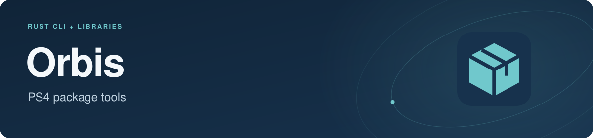
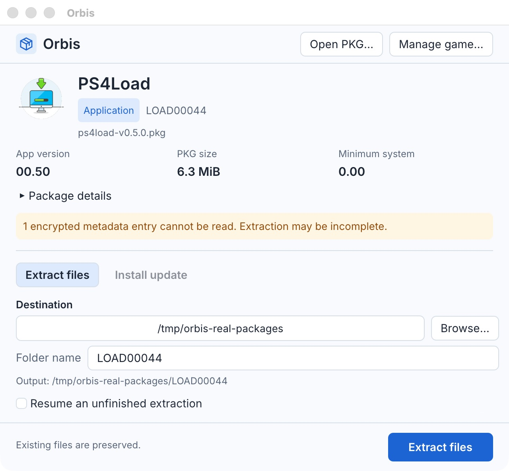
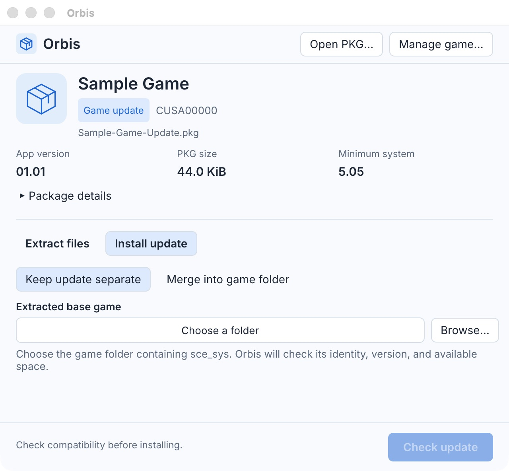

# Orbis: PS4 PKG extractor and update installer

[](https://github.com/Antti/orbis/releases/latest)
[](https://github.com/Antti/orbis/actions/workflows/ci.yml)

Orbis is a **PS4 PKG extractor** with a desktop app and command-line tool written in Rust for
**Windows, Linux, and macOS**. Extract PlayStation 4 packages, inspect `PARAM.SFO`
metadata, verify package integrity, install supported game updates for shadPS4,
and export a merged base game and update into one directory.

The `orbis` CLI is backed by Rust libraries for reading PS4 PKG archives
and PFS (PlayStation File System) images. This repository extends the original
[videobitva/orbis Rust project](https://github.com/videobitva/orbis) with update
management, merged exports, integrity checks, and additional platform builds.

**[Download Orbis](https://github.com/Antti/orbis/releases/latest)** ·
[Installation instructions](RELEASE.md#installing-packages) ·
[CLI reference](orbis-cli/README.md)

## What can Orbis do?

- **Extract PS4 PKG files:** unpack a whole package or selected files and directories.
- **Inspect packages:** list their contents and read title IDs, application versions,
  firmware requirements, and typed `PARAM.SFO` fields, including JSON output.
- **Check integrity:** verify readability, decompression, stored SHA-256 hashes,
  and supported PFS HMACs without extracting files.
- **Install full-file updates:** maintain shadPS4's sibling `-UPDATE` directory,
  keep the base intact by default, or merge into the game folder with original-file backups.
- **Export merged games:** copy the base and current update into a standalone
  directory with a SHA-256 manifest for later verification.
- **Resume interrupted work:** verify existing files before reusing them during
  extraction or export. Copy exports to exFAT USB drives as well as native filesystems.

## Desktop screenshots

Inspect package details, choose an extraction folder, and see warnings before
starting. This example opens the PS4Load homebrew package on macOS.



Choose the extracted base game and select whether to keep the update separate or
merge it into the game folder. **Check update** previews compatibility and space
before installation. This example uses a synthetic sample package.



## Download and install

For the graphical app, use an **orbis-desktop** archive from a release that includes
desktop assets. Extract it and double-click `orbis-desktop.exe` (Windows), `Orbis.app`
(macOS), or `orbis-desktop` (Linux). Choose **Open PKG**, then extract files or
preview and install a supported update. See the [desktop guide](orbis-desktop/README.md)
for platform requirements and source builds (`cargo run -p orbis-desktop --locked`).
CLI downloads use the **orbis-cli** prefix and contain the `orbis` command.

Download binaries from [GitHub Releases](https://github.com/Antti/orbis/releases/latest).
The release workflow builds these packages:

| Platform | Architecture | Package |
| --- | --- | --- |
| Windows | x86-64 | ZIP containing `orbis.exe` |
| Linux | x86-64 | AppImage or Flatpak |
| Linux | ARM64 / aarch64 | AppImage or Flatpak |
| macOS | Intel x86-64 | `.tar.gz` archive |
| macOS | Apple Silicon ARM64 | `.tar.gz` archive |

Check the assets attached to your chosen release. **Windows and Linux ARM64
downloads and the export/resume commands documented here require v0.3.0 or
later.** To build the current source with [Rust](https://www.rust-lang.org/tools/install):

```sh
cargo install --git https://github.com/Antti/orbis.git --locked orbis-cli
```

This installs `orbis` and the `orbis-pkg-util` compatibility command. The Cargo
package is `orbis-cli`; its shared Rust library is imported as `orbis_cli`.
These instructions build from this repository.
See the [platform installation guide](RELEASE.md#installing-packages) for checksum
verification, running downloaded executables, and Flatpak filesystem access.

## Quick start: extract a PS4 PKG

After installing the CLI:

```sh
# Read the game title, version, and package information.
orbis info game.pkg

# List metadata entries and files inside the package.
orbis list game.pkg

# Extract into a new directory.
orbis extract game.pkg --output ./extracted-game
```

The examples assume `orbis` is on your `PATH`. For an unpacked Windows
ZIP, use `./orbis.exe` in PowerShell from the executable's directory.
Downloaded AppImage and macOS archive commands are in the installation guide.

Without `--output`, extraction uses the title ID as the directory name. Existing
files are preserved unless you explicitly use `--force`. `--resume` checks
existing contents and copies missing files; it refuses conflicting files.

Select a file, inspect metadata as JSON, or verify stored integrity values:

```sh
orbis extract game.pkg -o ./metadata --metadata-only --path sce_sys/param.sfo
orbis info game.pkg --json
orbis verify game.pkg --integrity
```

`verify` without `--integrity` checks readability and decompression. Missing keys
or unavailable integrity checks produce exit code **3** (incomplete). See [CLI exit codes](orbis-cli/README.md#exit-codes)
and [encryption support](orbis-cli/README.md#encryption-support).

## Install a PS4 update for shadPS4

Start with an extracted base game. Stop the emulator, preview the update, then
install it:

```sh
orbis extract base.pkg -o ./games/CUSA12345
orbis install update.pkg --base ./games/CUSA12345 --dry-run
orbis install update.pkg --base ./games/CUSA12345
orbis status --base ./games/CUSA12345
```

The base remains in `CUSA12345`; the managed update lives beside it in
`CUSA12345-UPDATE`. The update must match the base title and content ID and have a
newer application version. Supported full-file updates replace the update layer;
binary delta patches are rejected.

To restore the retained installation:

```sh
orbis rollback --base ./games/CUSA12345
```

See the [update installation guide](orbis-cli/README.md#install-a-full-file-update)
for supported package types, space requirements, and crash recovery.

## Merge a base game and update into one directory

To update the game folder directly, choose **Merge into game folder** in the
desktop app, or use:

```sh
orbis install update.pkg --base ./games/CUSA12345 --merge --dry-run
orbis install update.pkg --base ./games/CUSA12345 --merge
```

Replaced originals are retained in `.<game>.orbis-install` beside the game.
Restore the original base before applying another update: **Manage game → Restore
base** in the desktop app, or `orbis rollback --base ./games/CUSA12345`. The PKG is
not needed for restoration. See [merge requirements and recovery](orbis-cli/README.md#merge-into-the-game-folder).

Use `export` to copy the original base and its separate update into a new directory.
If you merged in place, restore the base before installing a separate update.

```sh
# Install the desired update in separate mode first, if needed.
orbis install update.pkg --base ./games/CUSA12345
orbis export --base ./games/CUSA12345 -o ./merged-game --dry-run
orbis export --base ./games/CUSA12345 -o ./merged-game --resume
orbis verify-dir ./merged-game
```

Update files take precedence at matching paths; unchanged files come from the
base. The export contains independent copies and a `.orbis-export.json` manifest.
The original base, update, and rollback remain available. Repeating the resume
command verifies completed files before copying missing ones.

The output must be outside the source directories, and its parent must already
exist. A resumable export is visible while incomplete; use it only after success.
See [merged exports](orbis-cli/README.md#export-a-merged-game) for exFAT behavior,
space requirements, and consumer-specific requirements such as bbport/Bloodborne.

## Package support and common questions

### Does Orbis extract FPKG files?

Orbis supports the PS4 fake-package (FPKG) filesystem key scheme and includes the
entry key for slot 3. A known package passcode can derive all seven entry keys.
It cannot decrypt arbitrary retail PKGs; entries without usable keys are reported
as skipped. Readable metadata can still be inspected. See
[PKG encryption and passcodes](orbis-cli/README.md#encryption-support).

### Does extracting an update merge it with the base game?

`extract update.pkg` writes the update's own files. Use `install` to manage an
update alongside a matching base, then `export` when you need a single merged
directory. Export copies existing contents; it does not decrypt SELF executables,
apply binary deltas, or guarantee that a game will run in an emulator or port.

### Can I extract or export to an exFAT USB drive?

Yes. Orbis falls back to copying when the filesystem does not support exclusive
rename publication. Allow for temporary space and check `export --dry-run` first.
Use `--resume` from the start if you want to retain completed files after an
interruption. The [CLI guide](orbis-cli/README.md#extract-all-or-selected-files)
explains partial files, conflicts, and safe retries.

### Does verification prove a package is authentic?

Verification detects unreadable or changed data using the available stored
hashes and HMACs. It does not verify publisher RSA signatures, licenses, or
publisher authenticity. Export manifests are unsigned records of copied files.

## Rust libraries

| Crate | Purpose |
| --- | --- |
| [orbis-pkg](orbis-pkg/) | Parse PS4 PKG archives, read metadata, and access package payloads |
| [orbis-pfs](orbis-pfs/) | Read PFS filesystem images and compressed file data |
| [orbis-cli](orbis-cli/) | CLI and library for extraction, update installation, and merged exports |
| [orbis-integrity](orbis-integrity/) | Shared streaming integrity-check types with no runtime dependencies |

## Build and test

```sh
git clone https://github.com/Antti/orbis.git
cd orbis
cargo build --release --locked
cargo test --workspace --all-features --locked
```

The executable is `target/release/orbis` (`orbis.exe` on Windows).
To install from a local checkout, run `cargo install --path orbis-cli --locked`.
See [TESTING.md](TESTING.md) for regression coverage and real-filesystem tests,
and [RELEASE.md](RELEASE.md) for the version-bump release process.

## Performance

The original project reported the following timings for a roughly 30 GB
Bloodborne PKG (`CUSA03173_01`) on an Intel W-3175X, Samsung 990 Pro NVMe, and
192 GB DDR4-4000 six-channel memory:

| Tool | Min | Average | Max |
| --- | --- | --- | --- |
| `orbis` | 9 s | 16 s | 23 s |
| `shadPKG` | 73 s | 73 s | 75 s |

These are historical upstream results; the current release has not been benchmarked
under these conditions.
Storage speed, package contents, integrity checking, and filesystem copy fallbacks
affect runtime.

## Authors and maintainers

- **Original author:** [videobitva](https://github.com/videobitva) — the original Orbis Rust libraries and CLI.
- **Fork maintainer:** [Andrii Dmytrenko (@Antti)](https://github.com/Antti) — update installation, merged exports, integrity checks, CLI improvements, and release automation.

## Acknowledgements

- [shadPS4](https://github.com/shadps4-emu/shadPS4) — motivated the original project. Its since-removed PKG install code served as an initial format reference.
- [Obliteration](https://github.com/obhq/obliteration) — provided a Rust reference implementation for working with these formats.
- [shadPKG](https://github.com/seregonwar/ShadPKG) — used by the original project to validate extraction output.
- [PSDevWiki](https://www.psdevwiki.com/) — community-reverse-engineered PKG and PFS specifications.

## License

Licensed under either [Apache License 2.0](LICENSE-APACHE) or
[MIT](LICENSE-MIT), at your option.
