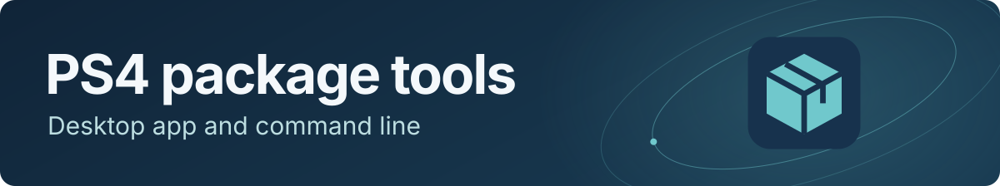
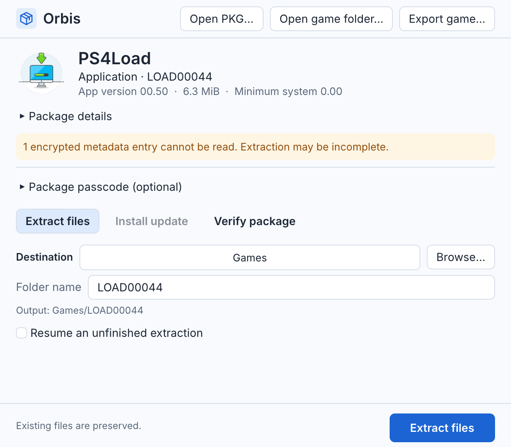
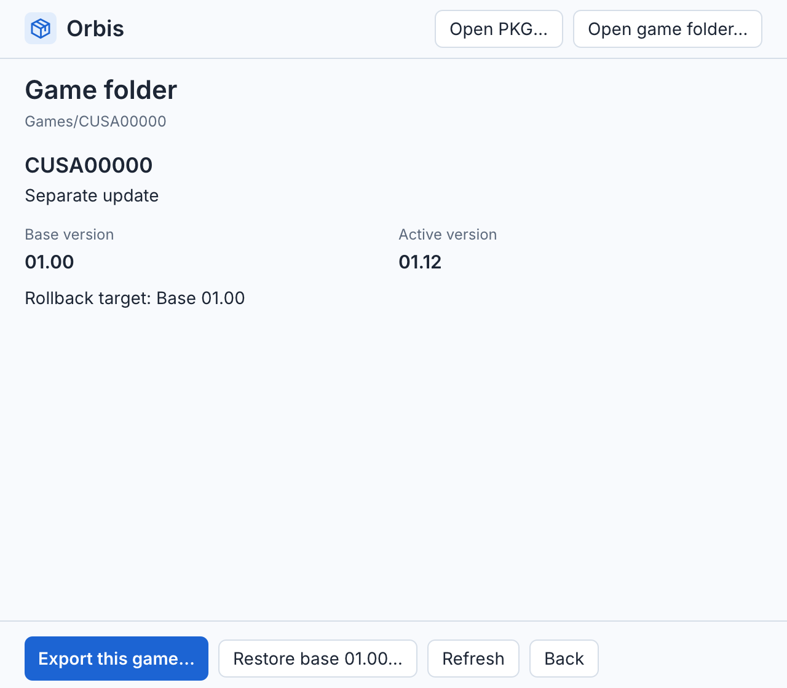

# Orbis



Orbis opens PlayStation 4 PKG files on Windows, macOS, and Linux. Use the desktop
app or the `orbis` command to inspect and extract a package, install a full-file
update for shadPS4, or export the base game and its update as a single folder.

**[Download Orbis](https://github.com/Antti/orbis/releases/latest)** ·
[Desktop guide](orbis-desktop/README.md) · [CLI reference](orbis-cli/README.md)

Choose the `orbis-desktop` archive for your platform, unpack it, and open
`Orbis.exe` (Windows), `Orbis.app` (macOS), or `Orbis` (Linux). For the command
line, choose an `orbis-cli` download. [Platform instructions and checksums](RELEASE.md#installing-packages)

The screenshots show `master`. The desktop game-folder view and the option to
combine `--resume` with `--dry-run` in `orbis export` were added after v0.5.0.
[Build from source](#build-from-source) to try them.

## Extract a package

Drop a PS4 PKG onto the window. Check the title and version, choose a destination
and folder name, then click **Extract files**. To continue an interrupted
extraction, select the same output and turn on **Resume an unfinished extraction**.



To try the package shown above, download [PS4Load](https://github.com/bucanero/ps4load/releases/tag/v0.5.0).
For your own game, use its title ID in place of `CUSA00000` in the CLI examples.

The examples assume `orbis` is on your `PATH`. In PowerShell, you can run the
downloaded CLI from its extracted folder, for example `.\orbis.exe info game.pkg`.

```sh
orbis info game.pkg
orbis list game.pkg
orbis extract game.pkg --output Games/CUSA00000
```

Orbis can read PS4 fake packages (FPKG). If an entry needs a key Orbis lacks,
it reports the omission and marks the extraction incomplete. A known package
passcode can unlock additional metadata. To check readability and stored hashes
without extracting files, run `orbis verify game.pkg --integrity`.
[Package keys and passcodes](orbis-cli/README.md#encryption-support)

## Install an update for shadPS4

Close the emulator and open the update PKG. Under **Install update**, select the
extracted base folder containing `sce_sys`. Leave **Keep update separate**
selected and click **Check update**. Review the versions and space estimate,
then click **Install update**.

```sh
orbis install update.pkg --base Games/CUSA00000 --dry-run
orbis install update.pkg --base Games/CUSA00000
orbis status --base Games/CUSA00000
```

The patch goes into `Games/CUSA00000-UPDATE` beside the original game. Use a
newer full-file update with matching title and content IDs. Orbis cannot apply
binary delta patches.

Drop the base game folder onto the window to see the active version. Orbis keeps
one rollback point. In this sample, **Restore base 01.00…** undoes update 01.12.
The CLI equivalent is `orbis rollback --base Games/CUSA00000`.



To update the base folder in place, select **Merge into game folder** or pass
`--merge` to `orbis install`. Keep the adjacent `.CUSA00000.orbis-install`
folder. It holds the originals you need to restore the base before the next
update. [Merge and recovery](orbis-cli/README.md#merge-into-the-game-folder)

## Export a single game folder

Choose **Export game…** and select the extracted base, or click **Export this
game…** in the game-folder view. Pick a destination outside the game and click
**Check export**. **Export and verify** copies the base and its separate update
to one folder. When a file exists in both, the export uses the updated version.
If you merged in place, restore the base and install the update separately first.

```sh
orbis export --base Games/CUSA00000 --output ./merged-game --resume
orbis verify-dir ./merged-game
```

Use `--resume` from the first run. If the copy is interrupted, repeat the command
to check completed files and copy what's missing. Add `--dry-run` to see how much
is left to copy. After moving the export to another drive, open a terminal in the
moved folder and run `orbis verify-dir .` to check its files against the SHA-256 manifest.
[Export destinations, space requirements, and exFAT](orbis-cli/README.md#export-a-merged-game)

## Build from source

From the repository root, run the desktop app or install the CLI with Cargo.

```sh
cargo run -p orbis-desktop --locked
cargo install --path orbis-cli --locked
```

The Rust libraries are [orbis-pkg](orbis-pkg/) for PKG archives,
[orbis-pfs](orbis-pfs/) for PFS images, and [orbis-integrity](orbis-integrity/)
for shared integrity checks. [Build requirements](orbis-desktop/README.md#build-and-run) · [Testing](TESTING.md)

## Credits and license

[videobitva](https://github.com/videobitva/orbis) wrote the original Rust
libraries and CLI. [Andrii Dmytrenko](https://github.com/Antti) maintains this
fork. The original project used [shadPS4](https://github.com/shadps4-emu/shadPS4)
and [Obliteration](https://github.com/obhq/obliteration) as format references,
checked extraction results against [shadPKG](https://github.com/seregonwar/ShadPKG),
and drew on the format documentation at [PSDevWiki](https://www.psdevwiki.com/).

Orbis is available under either the [MIT](LICENSE-MIT) or
[Apache 2.0](LICENSE-APACHE) license.
